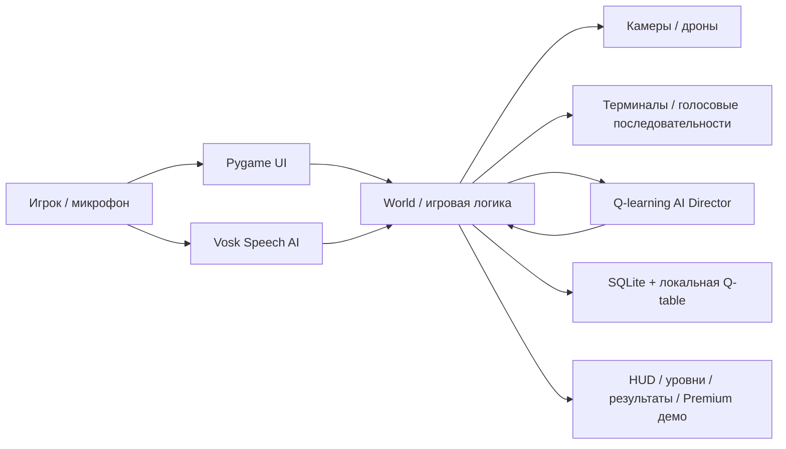

# Лабораторная №10 — План, WBS, риски, архитектура

## WBS (24 задачи)
| ID | Задача | Ответственный (роль) | Приоритет | Статус сборки |
|---|---|---|---|---|
| W01 | Игровая идея | PM | High | Готово |
| W02 | Сюжет трёх уровней | PM | High | Готово |
| W03 | Game Concept | PM | High | Готово |
| W04 | Требования и AC | PM | High | Готово |
| W05 | Прототип экранов | PM | High | Реализован в игре |
| W06 | Векторные персонажи | PM | High | Готово |
| W07 | Редактируемые карты | PM | High | Готово |
| W08 | Анимации персонажа | PM | Medium | Базовые |
| W09 | Аудиоэффекты | PM | Medium | Готово |
| W10 | Логические задачи | PM | High | Готово |
| W11 | Коллизии и передвижение | Tech | High | Готово |
| W12 | AI камеры | Tech | High | Готово |
| W13 | AI дронов | Tech | High | Готово |
| W14 | Логика турелей | Tech | High | Готово |
| W15 | Взлом и модули | Tech | High | Готово |
| W16 | Vosk интеграция | Tech | High | Код готов, нужен микрофон |
| W17 | Q-learning Director | Tech | High | Готово |
| W18 | SQLite | Tech | High | Готово |
| W19 | Магазин (демо) | Tech | High | Готово |
| W20 | UI настроек | PM | High | Готово |
| W21 | Unit tests | Tech | High | Готово |
| W22 | Тесты 3 участников вне команды | Общие | High | Не проведены |
| W23 | Приватный GitHub и PR двух студентов | Общие | High | Не подтверждено |
| W24 | Финальная демонстрация | Общие | High | Не проведена |

**Сроки по методичке:** недели 8–15. Точные фактические даты разработки и исполнительские коммиты заполнить при подтверждении.

## Kanban
Backlog → To Do → In Progress → Testing → Done. Используйте GitHub Projects; не создавайте фиктивную историю коммитов.

## Риски (P — вероятность, I — влияние, шкала 1–5)
| Риск | P | I | Реакция |
|---|---:|---:|---|
| Распознавание на шумном микрофоне | 4 | 4 | Шумоподавление и test-input; замер accuracy |
| Отсутствует модель Vosk | 3 | 5 | Отдельный загрузчик / инструкция |
| SDL/драйвер не запускает fullscreen | 3 | 4 | F11 и оконный режим |
| Карты создают непроходимый маршрут | 3 | 5 | BFS-тесты и walkthrough |
| Дрон замечает через стену | 3 | 4 | Проверки line-of-sight |
| Кривые конусы/низкий FPS | 3 | 3 | Ограничение числа лучей, профилирование |
| Конфликт изменений GitHub | 3 | 3 | Отдельные ветки и PR |
| Несоответствие учебному сроку | 4 | 5 | Приоритет MVP и обязательных критериев |

## Архитектура

## GitHub
Репозиторий должен быть **private**, преподавателю нужен доступ; оба студента должны иметь реальные коммиты и индивидуальные задачи. Эти действия невозможно подтвердить одним ZIP.
